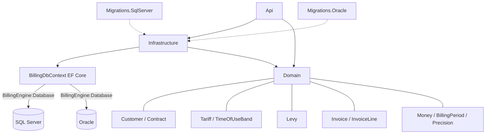

# energy-billing-engine

> C# billing engine for energy customers with Oracle and SQL Server support, traceable invoice calculation trees, and dynamic tariff comparison.


> **Status: in development.** The domain model and the database schema on SQL Server and Oracle exist; billing logic, PDF invoices and the APIs follow step by step. Every section below marks what is built and what is planned.

---

## Problem

Calculating an energy invoice is deceptively complex: tariffs change mid-period, contracts start on arbitrary dates requiring pro-rata splitting, network fees and levies are layered on top of the energy price, and VAT applies at different rates. When customers dispute their bill, a billing system must show every input value, every formula, and every intermediate result — not just a final number.

Money adds its own traps. Energy prices have more than two decimals (0.324517 EUR/kWh), invoices are rounded to cents, and the printed lines must add up to the printed total. A database column with too few decimal places rounds silently, so a stored invoice can stop multiplying out to its own amounts without anyone noticing.

This engine implements billing for electricity customers: from consumption to a printable invoice, with a full calculation trace exposed via API, and golden-master tests that lock in correctness against both SQL Server and Oracle.

---

## Features

Built:
- Domain model: `Customer`, `Contract` (one supply contract per market location at a time), `Tariff` with base price, energy price and time-of-use bands (e.g. a night rate across midnight), `Levy` rates with validity, `BillingPeriod`, `Invoice`, `InvoiceLine`
- `Money` value object: `decimal` + ISO 4217 currency, refuses to mix currencies, commercial rounding to cents
- Precision rules shared by domain and database: prices 6 decimals, quantities 5, amounts 2; values with more places are refused instead of silently rounded
- Pro-rata period splitter: a billing period is split at every tariff change (a change on the 15th gives days 1–14 and 15–31), with exact Europe/Berlin start and end instants for each part
- SQL Server and Oracle, selected by configuration, each with its own EF Core migrations (`Money` and `BillingPeriod` as complex types)
- Integration tests against both databases in real containers (Testcontainers)

Planned (see *Roadmap*):
- Pro-rata amounts per part (base price per day, consumption per part) and contract start/end within a period
- Meter reading based and interval (15-min) based billing with VAT
- Invoice generation as PDF (QuestPDF community license) and a cancellation (Storno) flow
- Golden-master invoice tests against both databases
- "Explain my bill": every invoice line exposes a traceable calculation tree (inputs → formula → result)
- Dynamic tariff: hourly synthetic spot prices vs. fixed tariff savings per customer

---

## Innovation

_Planned:_ "Explain my bill" (a calculation tree per invoice line, exposed via API) and a fixed vs. dynamic tariff comparison per customer. This section is filled in when they exist.

---

## Architecture

Today:



- **Domain** holds the rules and has no dependencies: a contract needs a valid MaLo-ID, two contracts can't supply the same market location at once, time-of-use bands can't overlap, an invoice period must overlap the contract, and every line amount is quantity × unit price rounded to cents once.
- **Infrastructure** maps the model to SQL Server or Oracle; `UseBillingStore` is the one place that picks the provider. `Precision` is the single source for decimal places, used by both the domain checks and the column definitions.
- **Migrations.SqlServer / Migrations.Oracle** hold each provider's migrations. Migrations are provider-specific SQL, so one set cannot serve both databases.
- **Api** only wires up the database so far.

Planned billing pipeline: `BillingService` → `PeriodSplitter` (pro rata) → consumption lookup → `LevyCalculator` → `VatEngine` → `Invoice` + calculation tree → PDF renderer / explain API.

---

## Quick Start

SQL Server (the default):

```bash
docker compose --profile sqlserver up -d
dotnet tool restore
dotnet dotnet-ef database update --project src/EnergyBillingEngine.Migrations.SqlServer --startup-project src/EnergyBillingEngine.Api
```

This creates the `EnergyBilling` database with all tables. The development connection string is in `src/EnergyBillingEngine.Api/appsettings.Development.json` and matches `docker-compose.yml`.

Oracle (the first start of the container takes a few minutes):

```bash
docker compose --profile oracle up -d
export BillingEngine__Database=Oracle
export ConnectionStrings__Billing="User Id=billing;Password=Billing_Dev_2026!;Data Source=localhost:1521/FREEPDB1"
dotnet dotnet-ef database update --project src/EnergyBillingEngine.Migrations.Oracle --startup-project src/EnergyBillingEngine.Api
```

The API reads the same two settings. Endpoints and example requests follow with the billing API.

---

## Domain Glossary

| German | English | Explanation |
|--------|---------|-------------|
| Endkunde / Letztverbraucher | End customer | The person or company that is supplied and invoiced |
| Liefervertrag | Supply contract | Contract to supply one market location under one tariff |
| Lieferbeginn / Lieferende | Start / end of supply | First and last day a contract supplies the market location |
| Marktlokation (MaLo) | Market location | Where energy is billed; 11-digit ID with check digit |
| Grundpreis | Base price / standing charge | Fixed amount per year, independent of consumption, billed pro rata per day |
| Arbeitspreis | Energy price | Price per kWh consumed |
| Hochtarif / Niedertarif (HT/NT) | Peak / off-peak rate | Time-of-use bands with different energy prices |
| Netzentgelt | Network fee | Fee for using the grid, charged by the grid operator |
| Konzessionsabgabe | Concession (franchise) fee | Fee paid to the municipality for using public roads |
| Stromsteuer | Electricity tax | Tax per kWh |
| KWKG-Umlage | CHP surcharge | Levy funding combined heat and power plants |
| Offshore-Netzumlage | Offshore grid surcharge | Levy funding offshore wind grid connections |
| EEG-Umlage | Renewable energy surcharge | Levy that funded renewable feed-in; zero since 1 July 2022, kept for older periods |
| Abrechnungszeitraum | Billing period | The billed calendar days, both ends included |
| Rechnungsposition | Invoice line | One line: quantity × unit price = amount |
| Kaufmännisches Runden | Commercial rounding | Half away from zero (0.125 → 0.13); what invoices use |
| Jahresverbrauchsabrechnung | Annual consumption invoice | Yearly settlement based on actual consumption vs. advance payments |
| Abschlag | Advance payment | Monthly instalment paid before the annual settlement |
| Storno | Cancellation / reversal | Formal correction of an already-issued invoice |

---

## Testing

```bash
dotnet test                                    # everything; integration tests need Docker
dotnet test --filter Category!=Integration     # unit tests only
dotnet test --filter Database=Oracle           # integration tests of one database
```

Unit tests (169, no database needed):
- `Money`: exact decimal arithmetic, currency mismatch refused, commercial vs. banker's rounding, why invoices round per line (three lines of 0.005 EUR print 0.03, not 0.02)
- `BillingPeriod`: inclusive days, leap years, months with a clock change still count calendar days
- `Tariff`: night band across midnight, adjacent vs. overlapping bands, currency and precision checks
- `Contract`: active days inclusive, no second contract for the same MaLo while one runs, follow-up from the next day
- `PeriodSplitter`: one part without changes; a change on the 15th gives 14 + 17 days; March 2026 has 31 days but 743 hours and October 745; a change on the spring clock-change day starts at local midnight; changes in any order; days without a tariff and two tariffs on one day are refused; 500 generated histories are checked day by day against a simple lookup
- `GermanCalendar`: days of 23, 24 and 25 hours, winter and summer offsets
- `Invoice`: line amounts rounded once, net total = sum of printed lines, prices/quantities with too many places refused, period must overlap the contract
- Database model, for SQL Server and Oracle: column types (`decimal(18,6)` prices, `decimal(18,2)` amounts, `date`/`DATE` for days, `char(3)` currencies), unique business keys, and a check that each provider's migrations match the model

Integration tests (6 per database, Testcontainers with the same images as `docker-compose.yml`): each test class is written once and runs against both databases. They apply the real migrations, then write with one context and read back with another:
- a customer reads back unchanged, including non-ASCII names
- duplicate customer numbers are refused by the unique index
- a full invoice (tariff with a night band across midnight, contract, lines) reads back with all six price decimals, the dates and the times of day
- the contract active on a given day is found by a date comparison in SQL
- the largest price the columns allow (12 + 6 digits) survives

CI runs one leg per database; unit tests run in both.

Planned: golden-master invoices.

---

## Design Decisions

Recorded in `docs/adr/` as the billing logic grows (planned: dual database provider, QuestPDF, calculation tree). Decisions made so far:

- **Commercial rounding, once per line.** German invoices round half away from zero, and each line is rounded when it is created, so the sum of the printed lines always equals the printed total. Banker's rounding is available explicitly.
- **Refuse, don't round silently.** Prices with more than 6 decimals or quantities with more than 5 are rejected by the domain, because SQL Server would round them on insert and the stored line would no longer match its amount.
- **Calendar days, not instants, for contracts and periods.** Contracts run "from 1 March"; the 23/25-hour clock-change days are one day each for pro-rata prices. Exact hours matter only for interval billing, so each part of a split period also carries its start and end as `DateTimeOffset` in Europe/Berlin. Counting days from those (743 h / 24 = 30.96 days for March) would bill the wrong amount.
- **A period must start with a tariff in effect.** The splitter refuses days without a tariff instead of filling them with the next one, because those days have no agreed price.
- **One migrations assembly per provider.** EF Core migrations contain provider-specific SQL. `UseBillingStore` points each provider at its own assembly, and a model test per provider fails if a change lacks a migration for either database.
- **Explicit date and time types on Oracle.** Oracle's EF Core provider has no native mapping for `DateOnly` and `TimeOnly` and would store them as `NVARCHAR2` text. They are converted to `DATE` and `INTERVAL DAY TO SECOND` instead, and a test pins the column types.
- **EF-generated sequential GUIDs as keys.** SQL Server orders `uniqueidentifier` by its last bytes, so sequential GUIDs keep inserts at the end of the clustered index; time-ordered UUIDv7 values would not.

---

## Roadmap / Next Steps

- Pro-rata amounts per part, levy calculator, VAT engine, billing service
- Calculation tree and "explain my bill" API
- QuestPDF invoices and Storno flow
- Golden-master tests
- Dynamic tariff with synthetic spot prices and a tariff comparison endpoint
- Later: SEPA direct debit XML, gas billing, MSCONS-driven billing via [edifact-energy-parser](https://github.com/hanan-raza/edifact-energy-parser) and [meter-data-service](https://github.com/hanan-raza/meter-data-service)

---

## Kurzfassung auf Deutsch

Diese Billing-Engine berechnet Energierechnungen für Endkunden nach den typischen Strukturen des deutschen Energiemarkts: Grundpreis, Arbeitspreis, Netzentgelt, Konzessionsabgabe, Steuern und Umlagen. Das Projekt ist im Aufbau; vorhanden sind das Domänenmodell (Kunde, Liefervertrag, Tarif mit HT/NT-Zeitzonen, Umlagen, Rechnung) und das Datenbankschema für SQL Server und Oracle, per Konfiguration wählbar. Geldbeträge sind ein eigener Werttyp mit Währung, der Währungen nicht vermischt und kaufmännisch auf Cent rundet, und zwar einmal pro Rechnungsposition. Preise mit mehr als sechs Nachkommastellen werden abgelehnt statt still von der Datenbank gerundet. Ein Abrechnungszeitraum wird bei jeder Preisänderung tagesgenau in Teilzeiträume zerlegt, auch über die Zeitumstellung hinweg. Als Nächstes folgen die Pro-rata-Beträge, Mehrwertsteuer, PDF-Rechnungen mit QuestPDF, Stornos und ein rückverfolgbarer Berechnungsbaum pro Rechnungsposition. Integrationstests laufen über Testcontainers gegen echte SQL-Server- und Oracle-Container und prüfen, dass beide Datenbanken dieselben Werte zurückliefern.
